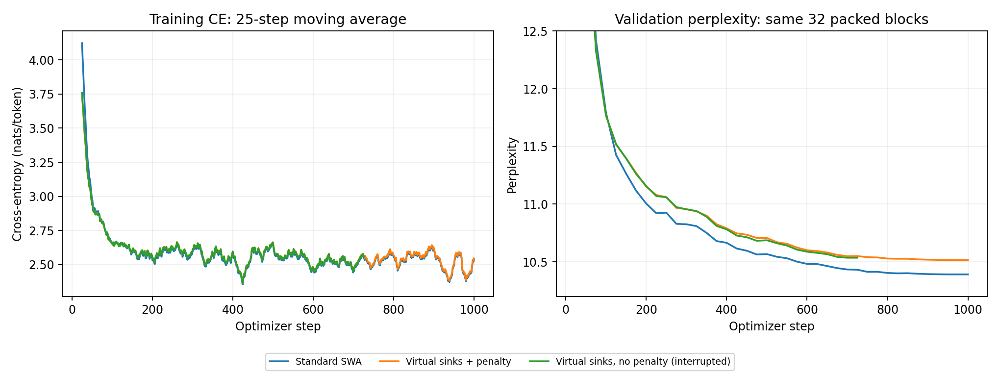
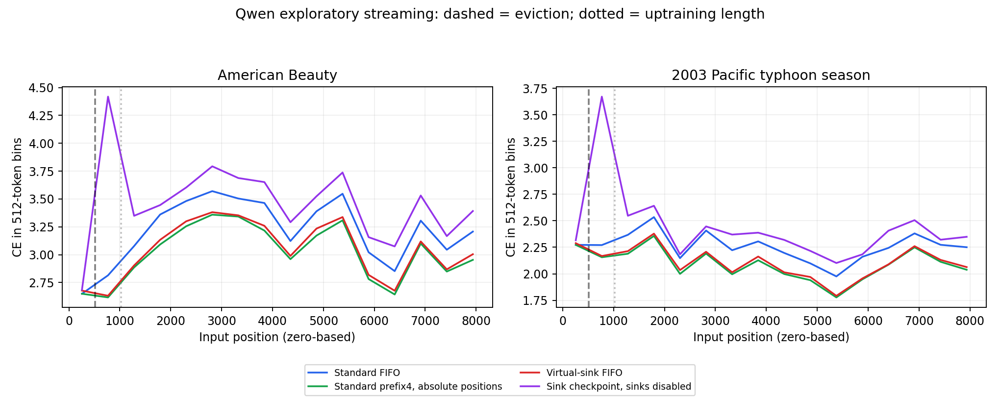
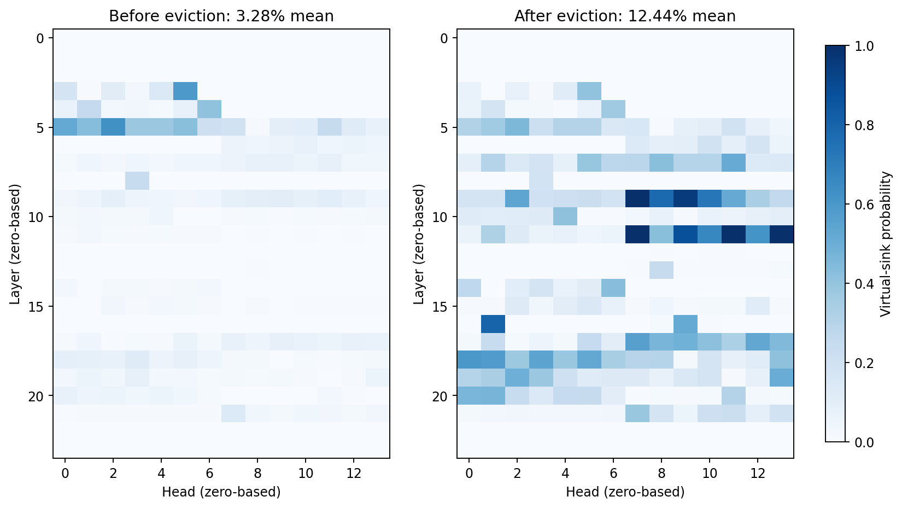
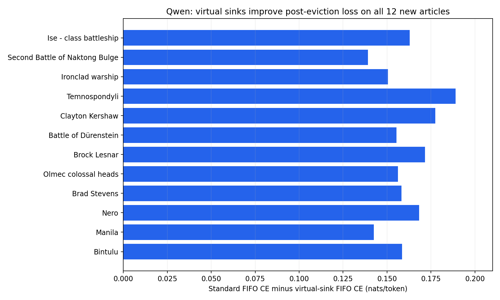

# Query-conditioned virtual sinks in Qwen2.5-0.5B

## Initial findings from continued pretraining and streaming evaluation

**VirtualSink research project · 14 September 2026**  
**Scope:** Qwen2.5-0.5B only. All four Qwen uptraining runs, their checkpoint interventions, physical-sink diagnostics, and subsequent streaming experiments through the 12-article confirmation study. Other model families and scratch-pretraining experiments are excluded.

## 1. Executive assessment

The strongest finding is a **cache-policy-dependent advantage**, not a general improvement in language-model perplexity. Adding query-conditioned virtual sinks and uptraining attention projections produced a Qwen checkpoint that performed slightly worse than a matched standard-attention control on short packed test blocks. Under sustained FIFO cache eviction, however, that checkpoint consistently outperformed the standard FIFO model.

On **12 newly evaluated long WikiText test articles**, excluding the two articles used in the exploratory streaming test, virtual-sink FIFO reduced post-eviction perplexity from **12.8905 to 10.9757**: a **14.85% reduction**, with an article-bootstrap 95% interval of **14.21–15.52%**. It improved cross-entropy on **all 12 articles**. The benefit persisted beyond ten cache windows. These evaluations used 8,192 next-token predictions per article and a strict 512-token physical cache. [E7]

The comparison with a stronger cache policy remains important. Retaining four initial physical tokens in the standard model produced **10.6959 perplexity**, versus **10.9757** for virtual-sink FIFO. Thus virtual sinks were approximately **2.62% worse** than that retained-prefix control. The control used absolute positions, not StreamingLLM-style positional rebasing; there is **no faithful rebased StreamingLLM comparison for Qwen in this report**. [E7]

| Main question | Finding | Interpretation |
|---|---|---|
| Can the adapter be uptrained on a K80? | Three planned 1,000-step runs completed in 8 h 15 min to 9 h 25 min each | Feasible with FP32, attention-only updates, and checkpointing |
| Does it improve short-block perplexity over matched standard uptraining? | Standard 11.6455; virtual sinks 11.7703 | No; the sink configuration was 1.07% worse on that test |
| Does the trained checkpoint rely on the sinks? | Disabling them raised SWA test PPL from 11.7703 to 27.8373 | Strong checkpoint dependence; not by itself evidence of better training |
| Does it help sustained FIFO streaming? | 12/12 new articles improved; 14.85% lower post-eviction PPL | Consistent benefit for the tested corpus/checkpoints/cache policy |
| Does it replace physical-token sinks? | The final non-SWA checkpoint still assigned 28.11% mean attention to the first physical token in the diagnostic | No; physical and virtual sinks coexist |
| Is the auxiliary penalty responsible for the short-block gap? | Removing it changed intermediate validation PPL only slightly; the run was cancelled at step 726 | No completed, matched-budget conclusion is available |
| Is query dependence better than a learned bias alone? | Small benefits in frozen bias-only interventions | Suggestive, but no separately trained bias-only control |

This report distinguishes **prediction quality**, **attention mass**, and **sensitivity to an intervention**. They answer different questions. High sink use is not itself success, and a sink-trained model being harmed by sink removal does not prove that adding sinks improved its training outcome.

## 2. From the original proposal to the executed experiment

Phase 1 established a working query-conditioned zero-value sink implementation. Phase 2 motivated continued-pretraining tests through controlled synthetic suppression/aggregation experiments. Those earlier results did not establish a streaming-language-model benefit; the uptraining and cache-eviction studies below address that separate question. [E0]

The initial Phase 3 proposal considered larger token budgets, BF16, and modern 16–24 GB GPUs. The executed work was more constrained:

- **Base model:** pinned pretrained `Qwen/Qwen2.5-0.5B`.
- **Hardware:** one Tesla K80 device per training job, approximately 11,441 MiB device memory.
- **Arithmetic:** FP32 model/optimizer computation under PyTorch 1.12.1+cu113; no BF16 or FlashAttention performance claim.
- **Update scope:** attention projections plus newly inserted sink parameters. No full-backbone Qwen fine-tuning was performed.
- **Budget:** 8.192 million input tokens and 1,000 optimizer iterations per completed training run, not the originally proposed billion-token-scale uptraining.
- **Dataset:** a pinned WikiText-103 subset. No PG-19 or book-corpus evaluation was performed in these runs.

The runs were continued pretraining of existing weights. They were neither training Qwen from scratch nor training a new tokenizer. Every new training arm started again from the same pinned pretrained backbone; the later SWA runs did not resume the 256-token checkpoint.

## 3. Mathematical formulation

### 3.1 Standard and virtual-sink attention

For layer \(l\), query head \(h\), query position \(t\), and visible physical key positions \(\mathcal V_t\), define the scaled physical logits

\[
z^{(l,h)}_{t,j}=\frac{\langle q^{(l,h)}_t,k^{(l,h)}_j\rangle}{\sqrt{d_h}},
\qquad j\in\mathcal V_t.
\]

Queries and keys already include RoPE. The implemented sink is an affine function of the rotated query:

\[
s^{(l,h)}_t=\langle q^{(l,h)}_t,w^{(l,h)}\rangle+b^{(l,h)}.
\]

The physical logits include the \(1/\sqrt{d_h}\) factor; the sink affine projection has no additional scaling factor in the implementation. Each query head has its own learned vector \(w\in\mathbb R^{d_h}\) and scalar bias \(b\). Its virtual value is zero.

\[
\alpha_{t,j}=\frac{e^{z_{t,j}}}{\sum_{i\in\mathcal V_t}e^{z_{t,i}}+e^{s_t}},
\qquad
\alpha_{t,\mathrm{sink}}=\frac{e^{s_t}}{\sum_{i\in\mathcal V_t}e^{z_{t,i}}+e^{s_t}}.
\]

Let \(Z_t=\operatorname{LSE}_{j\in\mathcal V_t}(z_{t,j})\). The total physical mass is

\[
G_t=1-\alpha_{t,\mathrm{sink}}=\sigma(Z_t-s_t),
\qquad
\alpha_{t,\mathrm{sink}}=\sigma(s_t-Z_t).
\]

The per-head value output is

\[
o_t=\sum_{j\in\mathcal V_t}\alpha_{t,j}v_j
=G_t\sum_{j\in\mathcal V_t}\operatorname{softmax}(z_t)_jv_j.
\]

For fixed queries, keys, and values, the virtual sink therefore gates the ordinary per-head attention output. It does not store past content or recover evicted information. Gating occurs before head concatenation and the output projection; it is not an instruction to skip the entire transformer layer.

The implementation uses a stable joint softmax with one extra scalar logit. No persistent physical sink K/V entry is added, but the method does add parameters and arithmetic. During training the attention implementation remains a query-chunked dense reference; an SWA mask does not turn it into a sparse or fused attention kernel. [E1, E2]

### 3.2 Visibility and streaming conventions

For full causal attention, \(\mathcal V_t=\{0,\ldots,t\}\). For the trained sliding window,

\[
\mathcal V_t=\{\max(0,t-w+1),\ldots,t\},\qquad w=512.
\]

The current input token counts toward the window. Streaming FIFO stores at most 512 physical K/V entries per layer and evicts the oldest before evaluating attention over the retained set. First eviction is at **zero-based input position 512**, predicting target token 513. A retained-prefix control instead keeps four initial tokens and 508 recent tokens. It has the same total physical cache budget.

The Qwen streaming experiments use absolute RoPE positions without rebasing. Cached hidden states are not recomputed from scratch, and the cache is not reset within an article. Positions beyond 1,024 exceed the uptraining sequence length, although all tested positions remain below the pretrained model's configured 32,768-position limit. Positional effects and cache eviction must not be conflated.

### 3.3 Training loss and reported perplexity

The language-model objective is mean next-token cross-entropy:

\[
\mathcal L_{\mathrm{LM}}=-\frac1N\sum_{t}\log p_\theta(x_{t+1}\mid x_{\le t}).
\]

The regularized runs use the user-selected anti-collapse objective. In each microbatch, average the physical gates over its batch and query-token axes:

\[
\bar G_{l,h}=\frac1{BT}\sum_{b,t}G_{b,t,l,h},
\qquad
\mathcal L_{\mathrm{aux}}=-\frac1{LH}\sum_{l,h}\log(\bar G_{l,h}+10^{-6}).
\]

\[
\mathcal L=\mathcal L_{\mathrm{LM}}+\gamma\mathcal L_{\mathrm{aux}},
\qquad\gamma=0.01.
\]

Microbatch objectives are averaged through gradient accumulation. The penalty discourages heads from putting nearly all mean probability on the virtual sink. It does **not** equalize head utilization or constitute MoE expert load balancing. It also exerts pressure against sink use, which can interact with the language-model objective.

The initially proposed entropy-like term proportional to \(H\sum_h\bar G_h\log[1/(\bar G_h+\epsilon)]\) was **not used** in these reported regularized runs. Its minima near the endpoints do not specifically rule out all-sink allocation, so the anti-collapse form above was selected instead.

The standard control disables/freezes sink parameters and applies no auxiliary loss. The no-penalty sink run uses `auxiliary=none`, `gamma=0`. **All reported perplexities exclude auxiliary loss**:

\[
\mathrm{PPL}=\exp(\text{mean held-out language-model CE}).
\]

Thus a perplexity difference is not the penalty being arithmetically added to the score. The penalty can still change the learned weights through its gradients.

## 4. Model, data, and shared training parameters

### 4.1 Pinned architecture and trainable weights

| Item | Executed setting |
|---|---|
| Model revision | `060db6499f32faf8b98477b0a26969ef7d8b9987` |
| Decoder layers | 24 |
| Query heads / K/V heads | 14 / 2 per layer; GQA repeats each K/V head across 7 query heads |
| Head dimension / hidden width | 64 / 896 |
| MLP intermediate width | 4,864; SiLU-gated MLP |
| Vocabulary | 151,936; tied embedding/unembedding weights |
| RoPE base / configured positions | 1,000,000 / 32,768 |
| Pretrained backbone parameters | 494,032,768 |
| Added sink parameters | \(24\times14\times(64+1)=21,840\) |
| Total parameters after insertion | 494,054,608 |
| Standard trainable attention parameters | 44,067,840 |
| Sink-arm trainable parameters | 44,089,680 |

All Q/K/V/O projection parameters, including existing projection biases where present, are trainable. MLP, embeddings, output vocabulary weights and layer-normalization parameters remain frozen. Sink initialization is \(w\sim\mathcal N(0,10^{-8})\), meaning standard deviation \(10^{-4}\), and \(b=-3.5\). There are 336 query heads in total. [E1–E3]

New sink parameters are not pretrained. However, their small parameter count does not guarantee either fast adaptation or eventual superiority. The more important change is the effect of their scores on the pretrained attention computation.

### 4.2 Corpus and packing

The source is `Salesforce/wikitext`, `wikitext-103-raw-v1`, revision `b08601e04326c79dfdd32d625aee71d232d685c3`. Official train, validation and test splits are kept separate. Training preparation preserves ordered nonempty source rows and appends EOS after each row; rows are packed without padding and attention can cross row boundaries.

The prepared Qwen streams contain **8,221,228 training tokens**, **139,946 validation tokens**, and **146,184 test tokens**. Completed training arms consume the first 8,192,000 input tokens without silently repeating the corpus. Source parquet and token-stream SHA256 hashes are recorded and checked. This is a relatively small continued-pretraining subset, not a complete billion-token adaptation campaign.

Training and short-block evaluation reset positions at sequence boundaries. Later streaming evaluation reconstructs individual articles and tokenizes their text directly, rather than using the EOS-after-every-row packed stream. Consequently, packed-block and article-stream perplexities are different protocols, even though both draw from WikiText's official test split.

### 4.3 Optimization and systems settings

| Parameter | Setting |
|---|---|
| Optimizer | AdamW, `foreach=False`; PyTorch defaults for betas (0.9, 0.999) and epsilon (1e-8) |
| Attention-parameter peak LR | 2e-5 |
| Sink-parameter peak LR | 1e-4 |
| Weight decay | 0.01 on base attention parameters; 0 on sinks |
| Scheduler | 100-step linear warmup followed by cosine decay through step 1,000 |
| Gradient clipping | Global norm 1.0 |
| Seed | 1729 |
| Precision / runtime | FP32; Python 3.9; PyTorch 1.12.1+cu113 |
| Microbatch | 1 sequence |
| Accumulation | 32 for length 256; 8 for length 1,024 |
| Query/CE training chunk size | 64 |
| Validation | Every 25 optimizer iterations; first 32 validation blocks |
| Checkpoint selection | Lowest recorded validation CE |
| Saving | Every 10 steps or 600 seconds, checked at optimizer boundaries; best/last/previous and 250-step milestones |
| Allocation | One K80, 4 CPU cores, 24 GB host RAM, up to 24 hours; trainer pause budget 23.5 hours |

The schedule begins at zero learning rate. The recorded 1,000 steps are optimizer iterations, not 1,000 identical nonzero-LR updates. The cosine schedule reaches zero at the end; nearly flat late losses alone do not prove that longer training with a new schedule could not help.

Gradient checkpointing and chunked vocabulary CE keep memory bounded. The completed 256-token sink run recorded approximately **2.53 GiB peak allocated GPU memory**; the SWA and no-penalty runs recorded approximately **2.83 GiB**. These are allocator measurements, not total device occupancy.

Slurm runs use isolated committed releases and shared storage. Checkpoints include full model weights, Adam and scheduler states, CPU/CUDA RNG states, step, best validation loss, configuration and provenance. Optimizer checkpoints are approximately 2.33 GB in decimal bytes. Temporary-file replacement and retention of the previous checkpoint reduce partial-write risk. [E1–E4]

## 5. Complete Qwen training inventory

All timestamps below are Cairo local time (UTC+3). Durations are actual Slurm runtimes, not requested time limits or earlier estimates.

| Run | Job | Context / attention | Auxiliary | Steps | Runtime | Start → end |
|---|---:|---|---|---:|---|---|
| A: original pilot | 214320 | 256 / full causal | Anti-collapse, γ=0.01 | 1,000 complete | **8:14:51** | Sep 9 17:02:33 → Sep 10 01:17:24 |
| B: matched standard control | 214328 | 1,024 / SWA 512 | None | 1,000 complete | **9:25:00** | Sep 10 01:04:14 → 10:29:14 |
| C: matched virtual-sink arm | 214330 | 1,024 / SWA 512 | Anti-collapse, γ=0.01 | 1,000 complete | **9:22:17** | Sep 10 01:17:44 → 10:40:01 |
| D: no-penalty sink arm | 214339 | 1,024 / SWA 512 | None, γ=0 | 726 logged; cancelled | **6:47:43** | Sep 10 11:08:42 → 17:56:25 |

The three completed runs each process **8,192,000 input tokens**. The corresponding prediction targets are 8,160,000 for run A and 8,184,000 for runs B/C, because the first token of each block is not a prediction target. Run D logs 5,947,392 input tokens and 5,941,584 prediction targets through step 726. Work after its last saved checkpoint is not necessarily recoverable.

The four jobs consumed **33:49:51 of training GPU allocation time in total**, excluding preparation and evaluation. Parallel execution means this sum is not calendar elapsed time.

## 6. Run A: 256-token full-attention uptraining

### 6.1 Purpose and outcome

This pilot tested whether the native Qwen adapter could be trained and checkpointed on a K80. It used full causal attention, a 256-token context, accumulation 32, and attention-only updates plus sinks. It completed 1,000 iterations; the **best validation checkpoint was step 850**, not the final step 1,000.

Validation perplexity before insertion was **19.6778**. Immediately after inserting initialized sinks it was **83.8006**, with approximately **6.04% mean virtual mass**. Best validation perplexity later reached **11.1709**. The large initial change is direct evidence that “small random sink weights” did not preserve this pretrained model's behavior.

The trainer's small final test evaluated 32 blocks and produced **17.4608 PPL** at the selected checkpoint. A later, larger frozen comparison used 256 blocks and produced the following results. These two test scores differ because they cover different test subsets; they are not contradictory measurements. [E1, E5]

| Frozen evaluation condition, 256 test blocks | CE | PPL |
|---|---:|---:|
| Original pretrained standard attention | 3.260839 | 26.0714 |
| Uptrained sinks enabled, best step 850 | 2.695820 | **14.8177** |
| Same checkpoint, sinks disabled | 2.710639 | 15.0389 |
| Same checkpoint, query weights set to zero; learned biases retained | 2.696970 | 14.8347 |

Disabling sinks raises perplexity by **1.49%**. The paired disabled-minus-enabled CE is **0.014819**, with a block-bootstrap 95% interval **[0.010933, 0.018425]**. Removing query dependence causes a smaller **0.115% PPL increase**. The latter is a post-training intervention, not a separately trained static-sink control.

**What this establishes:** the adapted checkpoint benefits from keeping its learned sink mechanism active. **What it does not establish:** improved uptraining versus standard attention. No standard-attention uptrained control was run at 256 tokens, so the original-to-adapted improvement cannot be credited to sinks alone.

### 6.2 Physical sinks in the final non-SWA checkpoint

A separate diagnostic explicitly loaded **last.pt at step 1,000**, not best.pt at step 850. It measured attention from query positions 128–255 over 128 held-out packed blocks, preventing trivial early-query causal constraints from dominating the first-token statistic.

| Attention diagnostic | Original model | Final sink-trained model |
|---|---:|---:|
| Mean first-physical-token mass | 34.87% | **28.11%** |
| Mean first-four-physical-token mass | 36.11% | **29.42%** |
| Mean virtual-sink mass | 0% | **2.085%** |
| Heads with >10% mean first-token mass | 255/336 | **223/336** |
| Heads with >50% mean first-four-token mass | 109/336 | **83/336** |

Some heads still assigned approximately 94% to the first physical token. This shows that physical and virtual sinks coexist. It does not prove whether the first token acts as a no-op or carries information. Position zero is the first packed token, not necessarily BOS. The reduction from the original model cannot be attributed solely to sinks because attention projections were also uptrained. The diagnostic's 2.085% virtual mass covers late queries; the larger step-850 evaluation averaged all positions and recorded about 2.128%, a different scope. [E8]

## 7. Runs B and C: matched SWA uptraining

### 7.1 Design

These arms provide the first direct trained-control comparison. Both restart from the original pretrained Qwen weights and use the same seed, ordered data, 1,024-token context, 512-token sliding window, accumulation 8, LR schedule and attention update scope. Run B disables/freezes the added sinks and has no auxiliary loss; run C trains the sinks with γ=0.01. Therefore the experiment compares the **combined sink-plus-regularizer configuration** against standard attention.

Both ran all 1,000 steps and selected **step 1,000** as best. Runtime was 9:25:00 for standard and 9:22:17 for sinks. This difference is too small and hardware-dependent to claim that sink attention is faster. There was no large practical runtime overhead in these runs.

The same pretrained backbone had **106.2469 initial validation PPL** under the imposed SWA mask. Inserting the initialized sinks changed it to **52.4057**, with **4.9269% virtual mass**. This again shows a non-neutral initialization, in this case improving the initial imposed-window score. It is not evidence that the final trained sink arm must beat the standard arm.

### 7.2 Final held-out result

The trainer's 32-block test produced 11.5223 PPL for standard and 11.6732 for sinks. The subsequent broader comparison used **142 identical 1,024-token test blocks**, or **145,266 prediction targets**, and is the principal short-block result below. [E2, E3, E5]

| Condition on the 142-block test | CE | PPL |
|---|---:|---:|
| Original pretrained standard model under SWA | 4.759307 | 116.6650 |
| Standard uptraining, step 1,000 | **2.454924** | **11.6455** |
| Sink uptraining, enabled, step 1,000 | 2.465580 | 11.7703 |
| Sink checkpoint, sinks disabled | 3.326378 | 27.8373 |
| Sink checkpoint, bias-only intervention | 2.471326 | 11.8381 |

The sink configuration is **1.071% worse** than standard on this evaluation. Standard-minus-sink CE is **−0.010656**, with a block-bootstrap interval **[−0.012391, −0.009000]**. Blocks are adjacent and correlated; the interval is not uncertainty across independent training seeds.

At the same time, disabling sinks in the sink-trained checkpoint increases PPL by **136.50%**, or 2.365×. Query-weight removal has a much smaller effect: **0.576% higher PPL**. Average virtual mass is **8.013%**, with **96/336 heads** above 10% mean virtual allocation.

These outcomes are compatible. The sink-trained attention weights adapted around the gate, making the checkpoint sensitive to removing it. The separately trained standard model followed another optimization trajectory and achieved a slightly better short-block solution. Dependence on a feature and improvement from adding that feature are distinct findings.

### 7.3 Loss trajectories

Training loss fluctuated: it rose between consecutive recorded steps in **492/999 comparisons for standard** and **491/999 for sinks**. Each step uses different text, so these fluctuations are not evidence of unstable optimization on a fixed objective batch. Validation is more comparable: it rose between checks only **4/39 times for standard** and **3/39 for sinks**.

Final validation PPL was **10.3910 standard** versus **10.5153 sinks**. The CE gap changed little from step 900 to 1,000, approximately **0.01194 to 0.01189**. That late segment did not show clear convergence of the two arms. The LR was also decaying to zero, so it cannot establish whether a longer, properly scheduled run would close the gap.

*Training is shown with a 25-step moving average. The validation panel zooms to the later-loss range; it omits the very high initial insertion scores. The interrupted no-penalty curve stops at the available measurements.*

## 8. Run D: removing the auxiliary penalty

This run tested the hypothesis that anti-collapse regularization was responsible for the sink arm's short-block disadvantage. It retained the same pretrained initialization, seed, data, SWA mask, learning rates, batch/accumulation and planned 1,000-step schedule. The changes were `auxiliary=none` and `gamma=0`.

The run was **cancelled**, not completed, after 6:47:43. It recorded **726 optimizer iterations**. The latest validation is step 725; the lowest recorded validation is at step 700. The last logged successful `last.pt` write is **step 720**. File timestamps alone are not a substitute for inspecting checkpoint contents; the evidence here is the checkpoint-write event in `metrics.jsonl`. Cancellation can therefore leave completed training iterations beyond the last durable checkpoint.

| Matched validation step | Standard PPL | Sinks, γ=0.01 | Sinks, γ=0 |
|---|---:|---:|---:|
| 525 | **10.5436** | 10.6704 | 10.6613 |
| 700 | **10.4337** | 10.5483 | 10.5353 |
| 725 | **10.4316** | 10.5497 | 10.5355 |

Removing the penalty modestly improves the sink arm at these checkpoints but does not remove the gap to standard. At step 725 the no-penalty model assigns **8.408% mean attention mass** to virtual sinks, with **100/336 heads** above 10%. Earlier measurements rose from approximately 4.09% at step 100 to 7.93% at step 525. [E4]

The dependent frozen evaluation, job **214340**, was cancelled as well. There is **no completed 1,000-step no-penalty test result and no no-penalty streaming result** in this report. Intermediate validation cannot be promoted to either claim. In particular, the subsequent streaming gains all concern the completed **regularized** checkpoint from run C.

## 9. Streaming evaluation: exploratory two-article test

### 9.1 Why this is a different test

The 1,024-token SWA evaluation already crosses one 512-token eviction boundary mathematically, but it resets each packed block and does not run a persistent cache through a long article. Sustained streaming was therefore evaluated separately rather than inferred from short-block PPL.

The streaming decoder preserves previous K/V states, evicts according to policy, and feeds the same ground-truth next tokens in every condition. This is teacher-forced autoregressive perplexity evaluation, not sampled generation. Loss is saved per token and in 128-token bins. It uses a fixed 512-entry cache and absolute RoPE positions; no window recomputation or within-article reset occurs.

| Condition | Checkpoint | Physical cache |
|---|---|---|
| Standard FIFO | Run B best, step 1,000 | Most recent 512 tokens |
| Standard retained prefix | Same run B checkpoint | First 4 + most recent 508 tokens |
| Virtual-sink FIFO | Run C best, step 1,000 | Most recent 512 tokens; virtual sink active |
| Disabled-sink FIFO | Same run C checkpoint | Most recent 512 tokens; virtual sink disabled |

The decoder passed 12 tiny-model tests and full-model cached-versus-parallel logit checks over 641 tokens for full and 512-window attention, including positions past eviction. Qwen's maximum observed absolute logit difference was **0.000326**, within the declared absolute/relative tolerances of 0.003/0.0001. Configurations, checkpoint hashes and source hashes are saved. [E6]

### 9.2 Results

Two individual official-test articles—*American Beauty (1999 film)* and *2003 Pacific typhoon season*—each supply 8,192 next-token predictions. Both are longer than this under the Qwen tokenizer. Neither is a concatenation of unrelated documents. Evaluation job **214481** completed in **1:08:18**.

The post-eviction segment is input positions **512–8191**, giving 7,680 targets per article. Pooling means averaging token CE and then exponentiating, not averaging article perplexities.

| Condition | Pooled post-eviction PPL |
|---|---:|
| Standard FIFO | 15.6936 |
| Standard retained prefix, absolute positions | **12.8915** |
| Virtual-sink FIFO | 13.2252 |
| Sink-trained checkpoint with sinks disabled | 19.7371 |

Virtual sinks reduce PPL by **15.73% versus standard FIFO**, while remaining **2.59% worse than the retained-prefix control**. Both articles show the FIFO advantage. Disabling the learned sink worsens predictions markedly. No blanket catastrophic-NaN pattern was observed; the evidence is a paired loss advantage, not a requirement that every baseline collapse.

Mean virtual mass rises from **3.285% before eviction** to **12.441% afterward**. The head heatmap is differentiated: **54/336 heads** have at least 30% post-eviction average virtual mass, and the strongest averages approximately **99.75%**. Mean per-head sink-vector norm grew from approximately **0.000798 to 0.052803**, yet all learned biases remained negative, approximately **−3.522 to −3.446**. Allocation depends on the score difference \(s-Z\), so positive biases are not necessary for high usage.

High/low token examples and per-token logits are retained. Isolated high-mass tokens include content fragments as well as formatting contexts; they do not establish a universal punctuation/idle-head rule. Changes after eviction can also include positional-distribution effects because the sink consumes rotated queries.

## 10. Streaming confirmation: 12 additional articles

### 10.1 Selection and statistical protocol

There are 62 top-level articles in the inspected official test split. Fourteen met the original study's joint minimum-length eligibility rule. The two already examined exploratory articles were excluded; **all 12 remaining eligible articles** were evaluated, with the titles fixed before observing their outcomes. Each supplies 8,192 predictions per condition. This yields **393,216 Qwen prediction evaluations** across 12 articles and four policies; each policy has 98,304 scored targets, of which **92,160 are post-eviction**.

Qwen array **214483** ran one article per task, capped at two concurrent Qwen GPUs. Individual Qwen tasks took **34:20–36:59**. The Qwen array ran from September 13 at 22:49:23 to September 14 at 02:26:14, approximately **3:36:51 calendar time**. The dependent aggregate report job **214485** completed at 02:54:04 after all required experiment units were available. All Qwen article tasks completed with exit 0:0. [E7]

For article \(d\), the predeclared primary endpoint is

\[
\Delta_d=\overline{\mathrm{CE}}_{d,\mathrm{standard\ FIFO}}-
\overline{\mathrm{CE}}_{d,\mathrm{virtual\ FIFO}},
\qquad t\in[512,8191].
\]

Positive values favor virtual sinks. The report averages \(\Delta_d\) over articles and obtains percentile intervals from **10,000 paired article bootstrap resamples**, seed 1729. It does not treat individual tokens as independent observations. The PPL ratio is \(\exp(-\bar\Delta)\). Equal scored lengths make the article-average CE equivalent to pooled token CE here.

### 10.2 Main results

| Condition | Post-eviction PPL | PPL beyond 10 windows |
|---|---:|---:|
| Standard FIFO | 12.8905 | 13.4681 |
| Standard retained prefix, absolute positions | **10.6959** | **11.0779** |
| Virtual-sink FIFO | 10.9757 | 11.3860 |
| Sink-trained checkpoint with sinks disabled | 15.4479 | 14.9089 |

The primary mean CE advantage is **0.160809 nats/token**, with a 95% article-bootstrap interval of **[0.153271, 0.168704]**. The sink/standard PPL ratio is **0.851455**, giving **14.85% lower PPL**, interval **14.21–15.52%**. Virtual FIFO wins on **12/12 articles**; even the smallest per-article CE advantage is positive, **0.139222**.

Beyond ten windows (input positions 5120–8191), the PPL reduction versus standard FIFO is **15.46%**, and all 12 articles still favor virtual sinks. Before eviction, however, the sink model is **1.78% worse in PPL** on average and wins only 2/12 articles. This contrast is important: it supports a benefit specific to the tested streaming/cache setting rather than uniform superiority on every segment.

| New article | Standard FIFO CE | Virtual FIFO CE | Advantage |
|---|---:|---:|---:|
| Ise-class battleship | 2.210461 | 2.047641 | 0.162820 |
| Second Battle of Naktong Bulge | 2.748423 | 2.609201 | 0.139222 |
| Ironclad warship | 2.686128 | 2.535648 | 0.150480 |
| Temnospondyli | 2.465019 | 2.276079 | 0.188940 |
| Clayton Kershaw | 2.105366 | 1.927849 | 0.177516 |
| Battle of Dürenstein | 2.881884 | 2.726547 | 0.155337 |
| Brock Lesnar | 2.719585 | 2.548002 | 0.171583 |
| Olmec colossal heads | 2.458999 | 2.302764 | 0.156235 |
| Brad Stevens | 2.567565 | 2.409310 | 0.158254 |
| Nero | 2.750624 | 2.582316 | 0.168309 |
| Manila | 2.704284 | 2.561830 | 0.142454 |
| Bintulu | 2.379585 | 2.221028 | 0.158557 |

The retained-prefix standard control is better than virtual FIFO on **all 12 articles**: the virtual/prefix PPL ratio is **1.026164**. This is a secondary comparison and uses the absolute-position policy. It does not support a claim that virtual sinks outperform a retained-prefix method.

Across these articles, mean virtual mass increases from **3.296% before eviction to 13.094% afterward**. Disabling the sinks increases post-eviction CE by **0.341791 nats/token** on average. Both observations are consistent with a learned gate helping the adapted checkpoint during FIFO streaming, while not establishing that the benefit specifically requires query-dependent parameters rather than a trained bias-only alternative.

### 10.3 What “confirmation” means here

The original two articles are not included in the confidence intervals. The 12 new articles provide consistent held-out-document evidence under a fixed protocol. They do not represent independently repeated training runs. Wiki articles share topics, and all data come from one corpus. Secondary comparisons—prefix retention, sink removal, and the beyond-10w segment—are descriptive and were not separately adjusted for multiple comparisons.

The supported claim is therefore:

> For these Qwen checkpoints, on the evaluated long WikiText articles, at a 512-token FIFO cache budget with absolute RoPE positions, virtual-sink uptraining improves post-eviction prediction loss relative to matched standard-attention uptraining.

## 11. Integrated interpretation and unresolved questions

**Short-block accuracy and long-stream robustness favored different configurations.** On the 142-block test, the standard model was modestly better; on sustained FIFO streams, virtual sinks were substantially better. The relevant result is the interaction between checkpoint and inference policy, not a single universal perplexity ranking.

**The trained model can use a feature without having found the best short-block solution.** Sink removal measures sensitivity of a jointly adapted checkpoint. A different training path without that feature can still achieve lower short-block loss. Fresh sink initialization, a non-neutral initial attention change, restricted attention-only updates, the auxiliary objective, and finite optimization time remain possible contributors; these experiments do not identify one as the sole cause.

**The no-penalty hypothesis remains only partly tested.** Its intermediate improvement was small, and cancellation prevents a completed equal-budget or streaming comparison. None of the 12-article confirmation gains should be described as a no-auxiliary result.

**Physical sinks were not eliminated.** The separate final non-SWA diagnostic found substantial first-token concentration. No corresponding physical-token concentration diagnostic was performed on the streaming SWA checkpoint, so the earlier observation should not be transferred without measurement.

**A faithful Qwen StreamingLLM comparison remains missing.** Retaining initial tokens was tested, but rebasing was not implemented in the Qwen conditions reported here. No claim against an official StreamingLLM reproduction is justified. The standard absolute-position prefix control already outperforms virtual FIFO on this corpus.

**Query dependence has not been isolated as the main source of benefit.** Frozen query-weight-zeroing interventions show small short-block effects, but a separately trained static/bias-only sink could adapt differently. Its streaming performance is unknown.

**Longer training could matter, but improvement is not guaranteed.** All sink parameters begin untrained. Their learning rate is higher, but the 1,000-step schedule is finite and ends at zero. A fair longer-budget test should extend both standard and sink arms under a deliberate schedule and equal added data budget, rather than extend only the favored arm.

## 12. Reproducibility and evidence locations

### 12.1 Training checkpoints on HPC

All paths below are under `/cluster/users/alex116u1/data/` (equivalently `~/data/`).

| Run | Relative checkpoint directory | Best / last information |
|---|---|---|
| A: full attention 256 | `phase3-k80-20260909/runs/qwen05/` | `best.pt`: step 850; `last.pt`: step 1,000 |
| B: standard SWA | `phase3-swa-20260910/runs/qwen05-standard/` | `best.pt` and `last.pt`: step 1,000 |
| C: regularized sink SWA | `phase3-swa-20260910/runs/qwen05-query_sink/` | `best.pt` and `last.pt`: step 1,000 |
| D: no-penalty SWA | `phase3-swa-noaux-20260910/runs/qwen05-query_sink/` | Best validation event: step 700; last logged checkpoint write: step 720; training logs extend to 726 |

Each directory contains the saved configuration, metrics JSONL and timing records. Completed runs have a trainer `summary.json`; this is the **32-block** final test and must not be confused with a larger dependent-evaluation summary. Full checkpoint payloads remain on HPC; local report generation used collected JSON/log evidence.

### 12.2 Evaluation outputs and runtime

| Evaluation | Job | Runtime | Relative HPC output directory |
|---|---:|---|---|
| Full-256 frozen sink interventions | 214331 | 00:05:17 | `phase3-swa-20260910/evaluations/qwen256/` |
| SWA-1024 frozen sink/control comparison | 214333 | 00:12:23 | `phase3-swa-20260910/evaluations/qwen05-swa/` |
| Final full-256 physical attention probe | 214335 | 00:01:23 | `qwen-final-physical-sinks-20260910/` |
| Two-article streaming pilot | 214481 | 01:08:18 | `uptrained-streaming-20260913/results/qwen05/` |
| Twelve-article streaming confirmation | 214483 array | 00:34:20–00:36:59 per article | `streaming-confirmation-20260913/results/qwen05/article00/` … `article11/` |
| Aggregate confirmation report | 214485 | 00:00:02 | `streaming-confirmation-20260913/REPORT.md` and `statistics.json` |

The streaming raw files include per-token CE, scalar sink scores and physical LSE, per-head probabilities, pre/post heatmaps, high/low token examples, and initial/trained sink parameters. Progress is saved every 512 predictions. Completed article/policy results are saved before proceeding; the aggregate report checks for every required complete unit and withholds a final conclusion if any is missing.

Relevant releases: original corrected training release `2fdfd7f`; SWA/control release `d18d483`; physical-sink probe `85e0ebc`; streaming evaluation `2214820`; expanded article evaluation `42f1711`. These historical release identities, not later unrelated workspace edits, define the evaluated implementations.

### 12.3 Local evidence index

- **E0 — Prior-phase context:** [Phase 1 and 2 report](E:/repos/VirtualSink/docs/reports/VirtualSink_Phase_1_and_2_Progress_Report.md).
- **E1 — Full-256 Qwen:** [configuration](E:/repos/VirtualSink/runs/k80-pilots/runs/qwen05/config.json), [metrics](E:/repos/VirtualSink/runs/k80-pilots/runs/qwen05/metrics.jsonl), [trainer summary](E:/repos/VirtualSink/runs/k80-pilots/runs/qwen05/summary.json), [pilot protocol](E:/repos/VirtualSink/docs/phase3-k80-runs.md).
- **E2 — Standard SWA Qwen:** [configuration](E:/repos/VirtualSink/runs/swa-1024-512/runs/qwen05-standard/config.json), [metrics](E:/repos/VirtualSink/runs/swa-1024-512/runs/qwen05-standard/metrics.jsonl).
- **E3 — Sink SWA Qwen:** [configuration](E:/repos/VirtualSink/runs/swa-1024-512/runs/qwen05-query_sink/config.json), [metrics](E:/repos/VirtualSink/runs/swa-1024-512/runs/qwen05-query_sink/metrics.jsonl), [SWA protocol](E:/repos/VirtualSink/docs/phase3-swa-protocol.md).
- **E4 — Interrupted no-penalty run:** [configuration](E:/repos/VirtualSink/runs/swa-noaux-1024-512/runs/qwen05-query_sink/config.json), [metrics](E:/repos/VirtualSink/runs/swa-noaux-1024-512/runs/qwen05-query_sink/metrics.jsonl).
- **E5 — Frozen comparisons:** [full-256 result](E:/repos/VirtualSink/runs/swa-1024-512/evaluations/qwen256/summary.json), [SWA result](E:/repos/VirtualSink/runs/swa-1024-512/evaluations/qwen05-swa/summary.json).
- **E6 — Exploratory streaming:** [Qwen comparisons](E:/repos/VirtualSink/runs/uptrained-streaming-20260913/summary/qwen05/comparisons.json), [provenance](E:/repos/VirtualSink/runs/uptrained-streaming-20260913/summary/qwen05/config.json), [streaming protocol](E:/repos/VirtualSink/docs/uptrained-streaming-protocol.md).
- **E7 — Confirmation:** [per-article data](E:/repos/VirtualSink/runs/streaming-confirmation-20260913/article_results.json), [statistics](E:/repos/VirtualSink/runs/streaming-confirmation-20260913/statistics.json), [fixed protocol](E:/repos/VirtualSink/docs/streaming-confirmation-protocol.md). These raw aggregate files contain other-model entries; only Qwen entries are used in this report.
- **E8 — Physical-sink probe:** [provenance](E:/repos/VirtualSink/runs/physical-sink-probe/qwen-final-physical-sinks-20260910/config.json), [final checkpoint attention](E:/repos/VirtualSink/runs/physical-sink-probe/qwen-final-physical-sinks-20260910/final_virtual_enabled.json).

The four Qwen-only figures can be regenerated with [build_figures.py](E:/repos/VirtualSink/docs/reports/assets/qwen-uptraining/build_figures.py). Numerical conclusions are traceable to the cited JSON; plots are explanatory views rather than substitute measurements.

## 13. Initial conclusion

The uptraining experiments establish a reproducible Qwen streaming benefit **relative to naive FIFO attention** at the tested 512-token cache budget. That benefit is larger and more consistent than the short-block effects, and it survives a preselected 12-article confirmation set. The experiments do not establish an overall better language model, superiority over retained-prefix/rebased attention, or a unique advantage of the query-dependent component over a trained static sink.

The next decisive comparison is a faithful Qwen rebased retained-prefix baseline, followed by additional corpora and training seeds. Completing the no-penalty arm and training a matched bias-only alternative would address the two most immediate training/mechanism ambiguities. Those are future experiments, not results included here.
