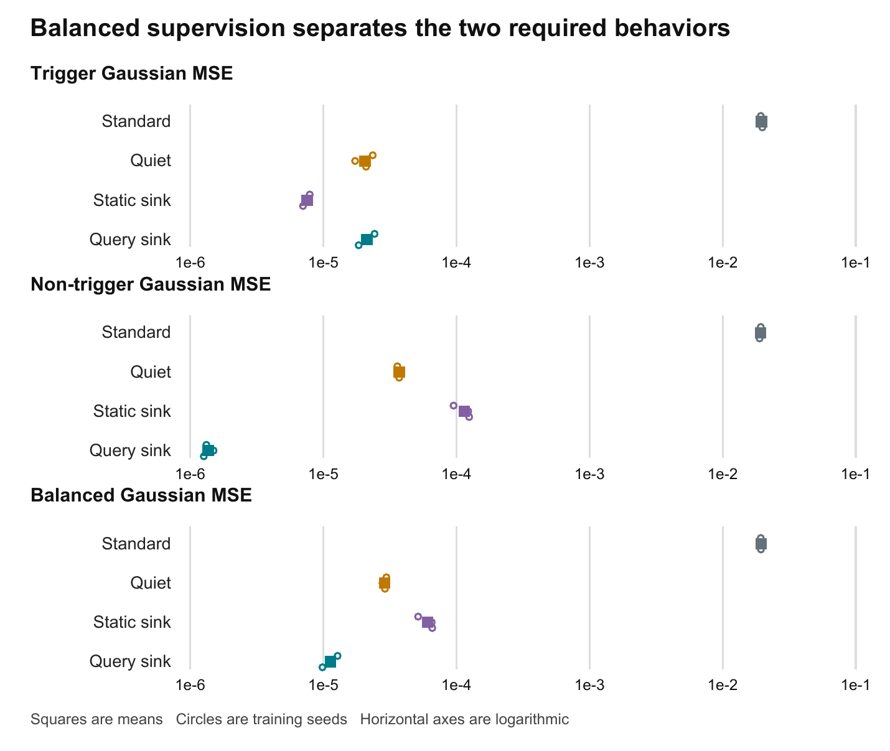
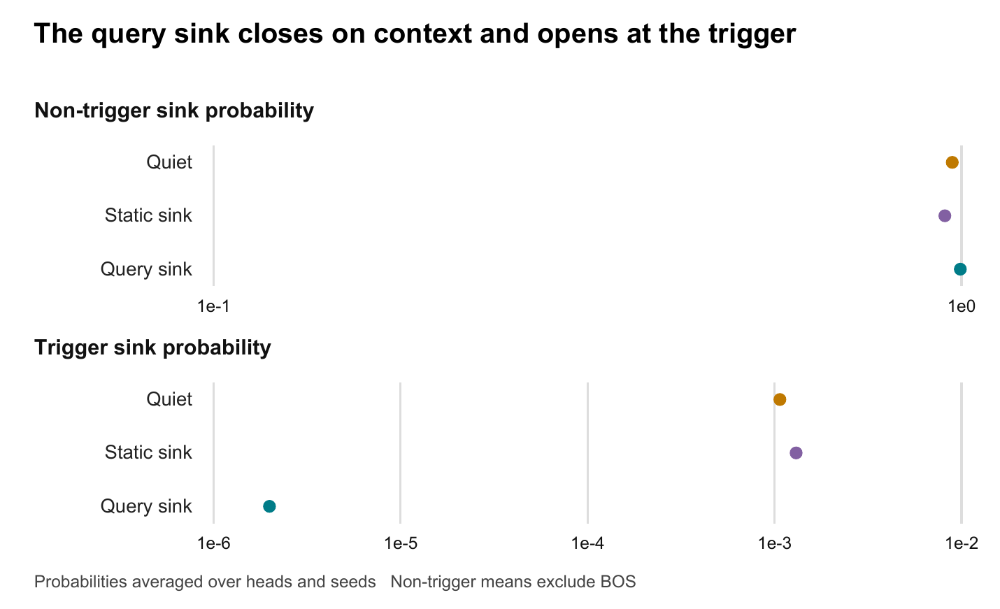

# Query Conditioned Virtual Sinks

## Progress through Phase 1 and Phase 2

VirtualSink research project  
Progress report  
7 September 2026

<!-- PAGEBREAK -->

## 1 Executive assessment

Phase 1 produced a working, numerically stable PyTorch implementation of query-conditioned virtual sink attention. Phase 2 produced a synthetic benchmark, four comparable attention variants, an initial transformer experiment, and a more controlled attention-only study. The controlled study completed 24 model runs across two loss functions and three seeds. The strongest result is conditional: with balanced trigger and non-trigger supervision, the query-conditioned sink achieved the lowest combined Gaussian-feature error of the four variants. Its advantage came primarily from suppressing unwanted output at non-trigger positions while retaining accurate aggregation at the trigger.

Under balanced training, mean balanced Gaussian MSE was 0.0000112994 for the query-conditioned sink, compared with 0.0000289092 for Quiet Softmax and 0.0000609281 for the static sink. These are reductions of approximately 60.9% and 81.5%, respectively. The query-conditioned model won this combined metric against both alternatives in each of the three seeds. Static sinks nevertheless achieved the lowest trigger-only error. With the original token-averaged loss, Quiet Softmax performed better than query conditioning. The evidence therefore supports a useful, task-dependent mechanism, rather than a universal ranking of attention methods.

The supplied novelty review provides the motivation and a proposed relationship to prior art. The experiments support the mathematical feasibility and synthetic behavior of the mechanism. They do not establish an exhaustive novelty claim, streaming language-model improvements, resistance to real KV-cache eviction, or a faster attention kernel. Those questions remain beyond the completed phases. [R1, E1–E4]

| Milestone | Work completed | Evidence and outcome |
|---|---|---|
| Phase 1 | Attention module, stable normalization, masks, initialization and gradients | Working dense reference implementation with unit and numerical tests |
| Phase 2 initial study | Two-layer transformer and four attention variants | All variants reached similar errors; no convincing query-sink advantage |
| Phase 2 controlled study | One attention layer, two losses, three seeds, separate Gaussian metrics | Query sink had the best combined Gaussian error under balanced supervision |
| End of Phase 2 | Mechanism diagnostics, saved checkpoints, reproducibility manifests | Stronger suppression and retained history attention observed; causal attribution remains incomplete |

The phase names in this report describe the actual implementation and experiment milestones. They are not claims that all systems proposals in the novelty review have been completed. Numerical results are held-out test measurements from the best validation-selected checkpoints unless a different scope is explicitly stated.

## 2 Motivation and relationship to the novelty review

Ordinary softmax attention distributes all its probability mass over available physical values. Sometimes a query should retrieve information; sometimes the desired update is approximately zero. A virtual sink adds an option that absorbs probability mass without contributing a value vector. Query conditioning makes the logit of that option depend directly on the current query, allowing different positions to suppress attention to different degrees.

This motivation should not be interpreted as a general impossibility theorem about ordinary attention. A weighted combination of values can be zero through cancellation, a zero value, or learned projections. Residual paths and later layers can also compensate. The practical hypothesis is that an explicit suppression mechanism makes the required behavior easier to represent or optimize in some settings.

The supplied document, Novelty Confirmation of Query-Conditioned Virtual Sinks, connects this idea to sliding-window attention: if a model relies on an initial physical token to absorb attention, evicting that token can change its behavior. StreamingLLM provides a relevant precedent for retaining initial tokens during streaming inference. This project explores a parameterized alternative that does not require a new sink entry in the physical KV sequence. The current experiments, however, use short, fully causal sequences without a sliding-window eviction experiment. [R1, R2]

### Prior art and the scope of the contribution

The review distinguishes physical token retention, fixed denominator offsets, learned scalar sinks, and input-dependent attention gates. These distinctions are useful for organizing a comparison, but naming a mechanism differently does not by itself establish novelty. In particular, a query-linear sink score can be represented algebraically as a learned global key with a zero value, if that key and a bias are included conceptually in attention. That equivalence must be addressed in a future literature assessment.

| Comparison | Relevant distinction | Status in this project |
|---|---|---|
| Physical sink retention | Keeps actual KV entries available | Discussed as motivation; not an experimental baseline here |
| Quiet Softmax | Adds a fixed denominator term equal to one | Implemented as sink logit zero |
| Static learned sink | Learns one scalar logit per head | Implemented with the same initial bias as the query sink |
| Query-conditioned sink | Learns a per-head vector and bias acting on the query | Implemented and evaluated |
| Input-dependent scaling | Changes effective attention magnitude using the input | Related prior-art family; requires a closer comparison |
| Fused streaming implementation | Integrates normalization into an efficient kernel | Proposed systems direction; not implemented |

Affine-Scaled Attention is relevant because it introduces input-dependent transformations of normalized attention weights. Sink-aware training is relevant because it analyzes an attention gate and proposes training methods to address head collapse. These papers make it especially important to separate the location of a gate in the equations from a broader claim that query-dependent gating is new. This report treats the novelty review as a research proposal and prior-art map, not as a verified patent or exhaustive literature opinion. [R3, R4]

## 3 Mathematical mechanism

For one head, let q be the projected query, k_j and v_j the projected physical keys and values, and d_h the head dimension. Let J contain the physical keys allowed by the causal, window and optional attention masks. The physical score is scaled by the square root of d_h. The sink score has its own learned vector w and scalar bias b.

$$z_j = q^T k_j / \sqrt{d_h}, \qquad s(q) = w^T q + b$$

The denominator includes the exponential of the sink score, but the numerator includes only physical values. Equivalently, the sink has a value of zero.

$$Z = \sum_{j\in J} e^{z_j}, \qquad p_j = \frac{e^{z_j}}{Z+e^s}, \qquad a = \frac{e^s}{Z+e^s}$$

$$o = \sum_{j\in J} p_j v_j = (1-a)\,o_{\mathrm{ordinary}}, \qquad 1-a = \sigma(\log Z-s)$$

Here a is the sink probability, and sigma is the sigmoid function. The ordinary attention output in this identity uses exactly the same projected query, keys, values and physical mask. Thus the sink is a scalar gate on each head's ordinary attention output. It changes the total physical mass without changing the relative probabilities among physical keys for a fixed set of logits.

The relevant decision variable is the margin between the sink logit and the physical log partition, not the sign of the sink logit alone. A sink logit of zero can dominate very negative physical scores; a positive sink logit can be negligible when the physical partition is much larger. This explains why Quiet Softmax and static sinks can still have query-dependent effective gates: their sink score is fixed, but their physical scores and Z depend on the query.

### Limits and optimization behavior

As the sink score becomes very negative relative to log Z, the physical probabilities approach ordinary softmax attention. As it becomes very positive, their total mass approaches zero and the attention output collapses toward zero. For an entirely masked physical row, the sink remains available, so the physical output is exactly zero rather than an undefined normalization of all negative infinities.

At fixed physical logits and values, the derivative of the head output with respect to the sink score is minus the sink probability times the output. This gives the learned sink a direct route to reduce the magnitude of unwanted attention output. A heavily closed gate can also attenuate useful training signals through the physical path, so initialization and the loss distribution matter.

The sink vector is initialized near zero, with standard deviation 0.0001, and the bias starts at −3.5. This makes the initial behavior close to ordinary attention under typical scores. For illustration, with one physical logit equal to zero, this bias gives about 2.93% sink probability; with 64 zero physical logits, it gives about 0.0472%. These are examples, not a bound valid for arbitrary inputs.

### Stable computation and memory meaning

The implementation forms physical logits, appends one sink logit per query and head, applies a stable softmax, and then uses only physical probabilities in the value-weighted sum. For half-precision inputs, the score and normalization path uses FP32. The output is cast appropriately for the surrounding projections.

No physical sink K or V tensor is added to the sequence, and there is no persistent sink KV-cache slot. There are still learned parameters, one additional scalar score per query and head, and associated intermediate tensors. Therefore “no sink KV entry” is precise; “zero additional memory or computation” is not.

This is a dense reference implementation. A sliding-window mask changes which entries may receive attention but does not avoid materializing the dense score matrix. Its score memory still scales with batch size, number of heads, query length and key length. A sparse or fused window kernel would be needed to turn a small attention window into a corresponding score-memory saving.

## 4 Phase 1 implementation and verification

The primary implementation is query_virtual_sink_attention.py. It contains bias-free query, key, value and output projections, plus one sink vector and one sink bias per attention head. Inputs use batch, sequence and model dimensions. The ordinary self-attention call can use one input tensor; the implementation also supports separate unprojected query, key and value tensors.

Queries and keys can have different sequence lengths when the key sequence is at least as long as the query sequence. Causal alignment treats a shorter query sequence as a suffix of the key sequence. This is useful API behavior for suffix attention, but it is not a persistent caching engine: maintaining, updating and evicting a cache is outside the module.

| Component | Implemented behavior | Why it matters |
|---|---|---|
| Causal mask | Each query sees only permitted past and current keys | Prevents future-information leakage |
| Sliding window | Further restricts physical keys by distance | Tests window semantics without changing dense allocation |
| Boolean mask | True means the physical key is allowed | Makes mask behavior explicit |
| Additive mask | Adds floating-point score adjustments | Supports score penalties and masking conventions |
| Virtual sink | Always remains available | Gives fully masked rows a defined zero output |
| Diagnostics | Detached physical weights, sink probability, sink logits and log partition | Enables mechanism analysis without retaining the training graph |
| Bias-free output | A zero head result remains zero after output projection | Preserves the suppression boundary |

The initial Phase 1 test suite passed 35 tests. Coverage included ordinary-attention equivalence when the sink is suppressed, output collapse when the sink dominates, mask semantics, causal and window behavior, finite gradients and double-precision gradient checking. Extreme-logit tests used values representable in the tested dtype: ±1,000,000 for FP32 and BF16, and ±10,000 for FP16. The comparison with PyTorch scaled dot-product attention checked agreement to an absolute tolerance below 0.00001 under the relevant setup.

By the end of the controlled experimental work, the project test suite had 64 passing tests and one skipped integration test. The skip concerned an external Slurm integration path, not the local numerical attention tests. A small end-to-end CPU experiment exercised both losses across all four variants, checkpoint selection and plot output. A PDF suffix bug found during that work was corrected before the completed controlled study. These checks support implementation reliability; they do not substitute for scientific replication of the findings.

Phase 1 did not implement a fused FlashAttention or FlexAttention kernel, rotary positional encoding, a production cache manager, grouped-query attention, or integration into a pretrained language model. These remain separate engineering tasks.

## 5 Phase 2 synthetic task

Each sequence has 64 positions and 64 input coordinates. Using zero-based indexing, position zero is the beginning-of-sequence token, abbreviated BOS. Exactly one trigger is sampled uniformly from positions 2 through 62. Coordinates 0, 1 and 2 identify BOS, trigger and ordinary context tokens, respectively. Coordinates 3 through 63 are independent standard Gaussian features at every position, including BOS and the trigger.

Every target vector is zero except at the trigger position j. At j, the target is the mean of the full input vectors at positions 1 through j−1. BOS and the trigger itself are excluded from that mean. For example, if j is 5, the target at position 5 is the mean of positions 1, 2, 3 and 4, and all other output positions should be zero.

$$y_t=0\ (t\ne j), \qquad y_j = \frac{1}{j-1}\sum_{i=1}^{j-1} x_i$$

The task asks for two different behaviors. At most positions the model should suppress its output. At the trigger it should recover a historical mean. This creates a setting in which query-specific suppression can be useful, while remaining small enough to inspect directly.

The first three coordinates also introduce a shortcut. The target at the trigger has context-indicator coordinate 2 equal to one and the other two indicator coordinates equal to zero. A predictor that recognizes the trigger and emits only that marker can reduce full-vector MSE without recovering any Gaussian history. This is why the controlled study reports Gaussian features separately from indicator coordinates.

### Sampling and baseline difficulty

Examples are generated deterministically from a base seed and example index. Each model trains on 192,000 sequence presentations over 3,000 steps with batch size 64. Validation and test each contain 512 fixed sequences. Matching seeds and example indices allow fair pairing within a study.

For an independent Gaussian coordinate, a mean of j−1 samples has variance 1 divided by j−1. Early triggers are therefore harder for the zero predictor than late triggers. The measured zero-predictor error depends on the realized trigger positions as well as Gaussian draws. This is one reason not to compare absolute errors across studies that use different evaluation seeds.

In the controlled test set, both the zero predictor and the indicator-only predictor have Gaussian trigger MSE 0.0785382 and zero Gaussian non-trigger error. Their full-vector errors differ because only the indicator-only predictor gets the target markers right. These baselines provide a concrete check that low overall error is not sufficient evidence of historical aggregation.

### Relationship to the cited trigger theory

This benchmark is not an exact replication of the cited theoretical task. The paper fixes BOS content to zero, includes the trigger in its specified target average, and studies a worst-case error criterion. Our generator gives BOS Gaussian content, averages strictly preceding context, and evaluates finite-sample mean squared error. Its restricted necessity results therefore cannot be transferred directly to these runs. In particular, weak BOS attention here does not refute that theorem. [R5]

## 6 Attention variants and training protocol

The experiment compares four normalization rules with matched projection structures. Standard attention has no virtual sink. Quiet Softmax uses a fixed sink logit of zero, equivalent to adding one to the exponential denominator. The static sink learns a scalar per head, initialized at −3.5. The query sink learns both a vector and a bias, with the same initial bias as the static arm.

| Variant | Sink score | Original model parameters | Attention-only parameters |
|---|---|---:|---:|
| Standard | No sink | 70,592 | 16,384 |
| Quiet | Fixed zero | 70,592 | 16,384 |
| Static sink | Learned bias | 70,600 | 16,388 |
| Query sink | Query dot learned vector plus bias | 70,728 | 16,452 |

The original model uses two pre-normalization transformer blocks, each with attention and a two-layer GELU MLP, residual connections, and a final linear prediction head. The MLP expands from 64 to 128 features and returns to 64. There are four heads, each of dimension 16, and no positional embeddings. Constructors are arranged so shared weights start identically across variants under the same seed.

All runs use AdamW with learning rate 0.001, weight decay 0.0001 and gradient-norm clipping at 1.0. The implementation checks for non-finite gradients. Validation is evaluated every 100 steps. Initial runs allowed early stopping after at least 1,000 steps, with patience 10 and a minimum improvement threshold of 0.0000001; all four nevertheless trained to 3,000 steps. The controlled runs disable early stopping and give every model exactly 3,000 optimization steps.

The two studies use different evaluation data. The original run uses seed 1729 and its original validation/test seed offsets. The controlled study uses run seeds 1729, 1730 and 1731, while holding a separate data seed of 2718 fixed for validation and test. Thus original and controlled absolute errors should be interpreted within their respective studies.

## 7 Original transformer results

The table below reproduces the user's initial results from the saved summary with additional precision where useful. All errors average over the full 64 output coordinates. Best step is chosen on validation, and test evaluation uses that checkpoint. [E1]

| Variant | Best step | Full MSE | Trigger MSE | Non-trigger MSE |
| --- | --- | --- | --- | --- |
| Standard | 3000 | 0.001210857 | 0.07559556 | 3.014768e-05 |
| Quiet | 2900 | 0.001190453 | 0.07476338 | 2.262835e-05 |
| Static sink | 3000 | 0.001204975 | 0.07541213 | 2.708341e-05 |
| Query sink | 3000 | 0.001204808 | 0.07536922 | 2.759475e-05 |

Quiet Softmax has the lowest overall and trigger errors in this first experiment. The query sink reduces overall error relative to standard by only about 0.50%, and relative to the static sink by about 0.014%. One seed and such small differences do not establish a meaningful query-conditioning advantage.

The full-vector zero-predictor trigger MSE is 0.0970665. Correcting only the context-indicator target reduces it to 0.0814415, without learning historical Gaussian content. The query model's trigger MSE of 0.0753692 improves on that indicator-only baseline by about 7.46%. This suggests some learning beyond the marker shortcut, but much less than the low all-token MSE initially seems to imply.

The loss distribution explains the ambiguity. Only one of 64 positions is a trigger. In the original loss, its contribution has weight 1/64; the 63 non-trigger positions together have weight 63/64. A model can therefore obtain a low reported error by being very good at producing zeros while remaining weak at aggregation. Conversely, a small increase in output leakage across many non-trigger tokens can outweigh a useful improvement at the one trigger.

Mechanism diagnostics were also weak in the first study. Standard attention assigned only roughly 2–4% average non-trigger attention to BOS across heads. Seven of the eight query-sink heads assigned less than 0.1% average non-trigger probability to the virtual sink. The remaining head used about 1.87% at non-trigger positions. The strong suppress-on-context and retrieve-on-trigger pattern anticipated by the proposal was not present overall.

The correct interpretation was therefore that the original experiment was inconclusive about the intended mechanism. Residual connections, normalization, MLPs and the prediction head offered alternative ways to reduce output error. The next experiment needed to remove those routes, separate the Gaussian task from marker prediction, and test loss imbalance explicitly.

## 8 Controlled attention only design

The follow-up replaces the two-block transformer with a single attention layer. It has trainable query, key, value and output projections, but no residual connection, normalization, MLP or extra prediction head. The output of attention is directly the model prediction. This makes an attention-based explanation more plausible, although learned value and output projections still provide other ways to change output magnitude.

The study crosses four attention variants with two loss functions and three seeds, giving 24 trained models. Within a seed, all variants and both losses use matching training examples and matching shared initialization. Across seeds, both initialization and the training sample stream change. All models share the same held-out validation and test sequences.

### Losses and checkpoint selection

The token-mean loss averages squared error across every position and coordinate. The balanced loss gives trigger and non-trigger groups equal weight, while still using all 64 coordinates in each group's MSE.

$$L_{\mathrm{token}} = \frac{1}{64}E_T + \frac{63}{64}E_N, \qquad L_{\mathrm{balanced}} = \frac{E_T+E_N}{2}$$

Here E_T is the full-coordinate trigger MSE, and E_N is the full-coordinate MSE averaged over non-trigger positions. Relative to token averaging, balanced supervision multiplies the trigger group's coefficient by 32 and reduces the non-trigger group's coefficient to about 0.508 of its former value. This changes the optimization objective deliberately; it does not simply change how results are displayed.

Each model selects its checkpoint using the matching validation objective: full MSE for token-mean training and balanced full-coordinate MSE for balanced training. Gaussian-only test metrics are diagnostic outcomes, not the checkpoint-selection criterion. The controlled study does not use a head-load-balancing regularizer. Balancing trigger and non-trigger regression loss is different from the auxiliary head-utilization methods discussed in the novelty review.

### Metrics and uncertainty

Gaussian MSE uses only coordinates 3 through 63, averaged per feature. Trigger and non-trigger metrics use their respective token groups. Balanced Gaussian MSE is the arithmetic mean of those two group metrics. It measures the quality of both required behaviors without allowing the 63 non-trigger positions to dominate simply because they are more numerous.

Results below are the mean and sample standard deviation over three trained seeds. They are not confidence intervals. Because evaluation data are shared across all seeds, the spread reflects training variability conditional on this test set; it does not measure uncertainty over independently sampled test sets. Head measurements are also correlated within a model and should not be treated as independent experimental replications.

## 9 Controlled results

### Token mean training

| Variant | Trigger Gaussian MSE | Non-trigger Gaussian MSE | Balanced Gaussian MSE |
| --- | --- | --- | --- |
| Standard | 0.0714686 ± 0.00063 | 1.46314e-05 ± 2.3e-06 | 0.0357416 ± 0.00032 |
| Quiet | 0.0476228 ± 0.0078 | 6.26865e-06 ± 4.1e-06 | 0.0238145 ± 0.0039 |
| Static sink | 0.0711017 ± 0.00081 | 1.54931e-05 ± 2.2e-06 | 0.0355586 ± 0.00041 |
| Query sink | 0.0571191 ± 0.00023 | 1.19087e-05 ± 1.9e-06 | 0.0285655 ± 0.00011 |

Under the original loss weighting, all methods retain substantial Gaussian trigger error while producing almost-zero non-trigger output. Quiet Softmax has the best mean balanced Gaussian error in this regime. The query sink improves on standard and static attention, but does not beat Quiet Softmax. The variation in Quiet Softmax trigger error is also appreciably larger than in the query-sink arm, although three seeds are insufficient for a reliable characterization of tail behavior.

### Balanced training

| Variant | Trigger Gaussian MSE | Non-trigger Gaussian MSE | Balanced Gaussian MSE |
| --- | --- | --- | --- |
| Standard | 0.0196036 ± 0.00026 | 0.0192197 ± 0.00023 | 0.0194116 ± 7.9e-05 |
| Quiet | 2.06095e-05 ± 3.1e-06 | 3.72089e-05 ± 1.2e-06 | 2.89092e-05 ± 9.7e-07 |
| Static sink | 7.57458e-06 ± 4.6e-07 | 0.000114282 ± 1.7e-05 | 6.09281e-05 ± 8.1e-06 |
| Query sink | 2.12356e-05 ± 2.9e-06 | 1.36326e-06 ± 1.2e-07 | 1.12994e-05 ± 1.5e-06 |

Balanced supervision substantially changes the outcome. The three sink variants learn far more accurate Gaussian aggregation than standard attention. Standard attention now has substantial errors in both groups, consistent with a compromise between producing useful output at the trigger and suppressing output elsewhere.

The static sink has the lowest Gaussian trigger MSE, about 0.00000757458. The query sink's trigger error is about 2.80 times that value, and is close to Quiet Softmax's trigger error. Its main advantage is non-trigger suppression: query-sink non-trigger Gaussian MSE is approximately 27.3 times lower than Quiet Softmax and 83.8 times lower than the static sink. This gives the query sink the best combined score.



Figure 1. Balanced-training test errors on Gaussian coordinates, plotted on logarithmic axes. Circles show the three training seeds; squares show their arithmetic means. Lower values are better. Separate panels prevent a good trigger score from hiding unwanted non-trigger output. Source: saved study_summary.json.

The balanced Gaussian score for the query sink is about 1,718 times lower than standard attention's score in this setup. That large ratio describes this synthetic attention-only benchmark; it is not an estimate of a language-model quality gain. The smaller and more informative comparisons are against the other sink methods, which can also solve much of the task.

All three seeds show a lower balanced Gaussian error for the query sink than for either Quiet Softmax or the static sink. This consistency strengthens the observation, but it is still a small-seed result at one sequence length, dimension and optimization schedule. No formal significance claim or general superiority claim is warranted from these runs alone.

## 10 What the learned attention is doing

The mechanism analysis records physical attention probabilities and the virtual sink probability for each head on held-out test sequences. Non-trigger mechanism statistics exclude BOS, so their population differs slightly from the non-trigger regression metric, which includes every non-trigger output position. The following table pools the four heads across the three balanced-training seeds by averaging their reported means. [E3]

| Variant | BOS mass on non-triggers | Sink mass on non-triggers | Sink mass on triggers | History mass on triggers |
| --- | --- | --- | --- | --- |
| Standard | 5.8874% | 0% | 0% | 99.955% |
| Quiet | 0.31604% | 97.188% | 0.10677% | 99.759% |
| Static sink | 0.56993% | 94.996% | 0.13039% | 99.848% |
| Query sink | 0.074419% | 99.629% | 0.00019884% | 99.814% |

The query sink assigns approximately 99.63% of attention mass to the virtual sink at non-trigger positions. Its average sink logit is about 8.17 there and about −9.75 at triggers. At triggers, sink probability is approximately 0.0002%, while about 99.81% of the mass goes to the intended historical context. These measurements are consistent with a learned switch between suppression and retrieval.

The physical history mass alone does not establish a correct mean: putting all mass on one previous token would still yield high history mass. The diagnostic therefore also compares the full physical attention row with the ideal uniform distribution over the intended history. Mean L1 discrepancy is about 0.00600 for the query sink, 0.00631 for Quiet Softmax, 0.00499 for the static sink and 0.0651 for standard attention. The query sink is thus combining strong suppression with approximately uniform historical attention, while the static sink is slightly closer on this distributional trigger metric.



Figure 2. Mean virtual sink probability on non-trigger and trigger positions, averaged over heads and seeds. The non-trigger statistic excludes BOS. The logarithmic scale exposes the very small trigger sink probability of the query-conditioned model. Standard attention has no virtual sink and is omitted from this plot.

Quiet Softmax and static sinks also show high non-trigger sink use and low trigger sink use. Their fixed sink score does not prevent an effective query-dependent gate because their physical partition changes with the query. The additional learned query term provides another way to separate those conditions, and the measured benefit here is especially low leakage at non-trigger positions.

These are observational diagnostics from trained models. They do not isolate causality. Trainable value and output projections may contribute to the low error, and head outputs can interact through the output projection. A stronger causal test would freeze a trained model and replace, clamp or remove the sink score while measuring the resulting error changes. That intervention has not been performed in the completed study.

## 11 Systems status and execution record

Saved run configurations identify CUDA execution with PyTorch 2.11.0+cu126. The original four model runs sum to approximately 6.10 minutes of recorded per-variant elapsed time. The controlled 24 model runs sum to approximately 33.31 minutes. These are recorded run durations, not a controlled kernel throughput comparison or total wall time including all setup, process startup and reporting overhead.

The extra parameter count is small in the attention-only setting: the query sink adds 68 trainable scalars to a 16,384-parameter standard attention model. Small parameter overhead does not guarantee negligible runtime overhead in a dense Python/PyTorch implementation. Appending logits, precision conversions and intermediate allocation can matter, and this study was not designed to measure those costs.

The novelty review proposes folding the sink into an online attention normalization. Mathematically, if the physical attention calculation has running maximum m, exponential sum l and weighted numerator u, adding the sink requires updating the maximum, rescaling both accumulated quantities, and adding the sink exponential only to the denominator. The numerator receives no sink value contribution. Failing to rescale the existing numerator when the maximum changes would give the wrong result.

That algebra is a plausible route to a fused implementation, but no such kernel was built or benchmarked in these phases. There is also no completed test of long-context cache eviction, rotary positions, language-model perplexity, end-to-end generation speed or training memory at production scale. The implementation establishes a reference against which future kernels can be checked.

## 12 Limitations and claim boundaries

The strongest empirical statement is that a query-conditioned denominator sink can learn useful suppression on this task, and under balanced supervision it achieves the best mean combined Gaussian error among the tested variants. The following boundaries prevent the result from being overstated.

| Proposed or possible claim | Evidence through Phase 2 |
|---|---|
| Query-conditioned sink attention is implementable and differentiable | Supported by implementation and numerical tests |
| The sink can suppress context output while retaining trigger retrieval | Supported by balanced-study errors and attention diagnostics |
| Query conditioning improves every metric or training regime | Not supported; Quiet wins token-mean training and static wins balanced trigger error |
| Ordinary attention must concentrate on BOS in this benchmark | Not observed; our task also differs from the cited theorem |
| The sink mechanism alone caused the error improvement | Not isolated by an intervention |
| The proposal is conclusively novel across literature and patents | Not established by this report or these experiments |
| Sliding-window eviction and RoPE stability are solved | Not evaluated |
| The implementation saves dense attention score memory | Not supported; scores remain dense |
| A fused kernel has negligible overhead or improves speed | Not implemented or benchmarked |

Three seeds, one task family and one test set leave substantial external uncertainty. Shared evaluation examples help controlled comparison but do not demonstrate generalization across data distributions. The study does not vary sequence length, trigger frequency, dimension, head count or noise distribution. Trigger position also changes target variance; aggregate metrics can conceal position-dependent failures.

Optimization is another open factor. Quiet Softmax starts with sink logit zero, whereas the learned sink variants start with bias −3.5. The static and query comparison matches that bias, but comparisons with Quiet also include an initialization difference. Learning rate, bias initialization, weight decay and training budget have not been swept. Several best checkpoints occur at the final step, so some methods may not have reached their best achievable performance.

Finally, the controlled experiment was motivated by inspection of the initial study. It is a transparent follow-up, not a preregistered independent confirmation. Within the controlled run, checkpoints use validation objectives rather than test scores. A future confirmatory experiment should fix the protocol before evaluating a fresh test set.

## 13 Recommended next phase

The next phase should strengthen the explanation before expanding the systems claims. First, intervene on saved checkpoints: clamp the query sink to a static score, replace it with its mean, or disable it while retaining the same projections. Compare trigger and non-trigger Gaussian errors before and after each intervention. This directly tests whether learned query dependence contributes to the observed advantage.

Second, run task controls that separate the benchmark from the theory. Include an explicitly zero-valued BOS condition, a paper-aligned target definition, and position-bucketed metrics. A true zero physical sink makes the comparison with virtual suppression more informative. Preserve the current strict-history task as a separate condition rather than silently changing its definition.

Third, test robustness across more training seeds, fresh evaluation sets, longer sequences and different trigger rates. Report the paired differences between query and static sinks, not just independent error bars. Sweep matched initial biases and a modest range of learning rates so optimization choices are not mistaken for architectural limits.

Only after those controls should the systems phase integrate the mechanism into a real streaming attention path. That work should verify online-normalization equivalence, backward gradients, cache behavior and positional handling, then benchmark memory and throughput against appropriate fused baselines. Language-model evaluations should separately test short-context quality, long-context streaming behavior and sensitivity to physical sink eviction.

The end-of-Phase-2 decision is to continue investigating the mechanism with these controls. The evidence is sufficiently promising to justify further work, while remaining too narrow to justify a claim of general superiority or deployment readiness.

## Appendix A Reproducibility and evidence index

The repository root for this report is E:/repos/VirtualSink. The paths below identify evidence relative to that root. Original run artifacts are preserved separately from the controlled study. Checkpoint files contain model state and configuration for evaluation; they do not contain optimizer state for exact training resumption.

| Evidence ID | Repository path | Purpose |
|---|---|---|
| E1 | runs/local-trigger/summary.json | Original validation-selected test results and timings |
| E2 | runs/attention-control/study_summary.json | All controlled runs and aggregate statistics |
| E3 | runs/attention-control/{loss}/seed-{seed}/mechanism_summary.json | Per-head held-out attention measurements |
| E4 | runs/attention-control/study_config.json | Study settings and six source SHA256 hashes |
| E5 | query_virtual_sink_attention.py | Phase 1 attention implementation |
| E6 | synthetic_dataset.py and toy_models.py | Data and model definitions |
| E7 | run_ablation.py and run_controlled_ablation.py | Training, selection and study orchestration |
| E8 | visualize_mechanisms.py | Attention diagnostics and plots |
| E9 | test_query_virtual_sink_attention.py, test_trigger_experiment.py and test_controlled_ablation.py | Verification coverage |

The saved study manifest records source hashes so subsequent changes can be detected. The report's numeric tables are generated from saved JSON, not transcribed from chart images. Both delivered document formats use the same report source. Displayed values are rounded for readability; the saved JSON remains the source for exact calculations.

The command below documents the completed controlled protocol. It is not executed as part of report creation. A fresh output directory is required to protect existing results. Any future execution should follow the repository's current execution policy and available environment.

```text
python run_controlled_ablation.py --output-dir runs/attention-control-repeat --device cuda --seeds 1729 1730 1731 --data-seed 2718 --steps 3000 --batch-size 64 --d-model 64 --seq-len 64 --n-heads 4 --validation-samples 512 --test-samples 512 --eval-every 100 --threads 4
```

## Appendix B Per seed controlled results

The tables list every model's selected step and test Gaussian errors. T denotes trigger MSE, N non-trigger MSE, and B their equally weighted mean. Selected steps can differ even though every model trained for 3,000 steps. These are individual runs, not additional independent test sets.

### Token mean runs

| Seed | Variant | Best step | T | N | B |
| --- | --- | --- | --- | --- | --- |
| 1729 | Standard | 3000 | 0.0708246 | 1.19873e-05 | 0.0354183 |
| 1729 | Quiet | 3000 | 0.0387719 | 1.97396e-06 | 0.0193869 |
| 1729 | Static sink | 3000 | 0.0702346 | 1.29018e-05 | 0.0351238 |
| 1729 | Query sink | 3000 | 0.0572416 | 9.80429e-06 | 0.0286257 |
| 1730 | Standard | 3000 | 0.0720928 | 1.61738e-05 | 0.0360545 |
| 1730 | Quiet | 3000 | 0.0505333 | 6.75006e-06 | 0.02527 |
| 1730 | Static sink | 3000 | 0.0718395 | 1.68471e-05 | 0.0359282 |
| 1730 | Query sink | 3000 | 0.0572618 | 1.34512e-05 | 0.0286376 |
| 1731 | Standard | 3000 | 0.0714882 | 1.57333e-05 | 0.035752 |
| 1731 | Quiet | 3000 | 0.0535633 | 1.00819e-05 | 0.0267867 |
| 1731 | Static sink | 3000 | 0.0712309 | 1.67304e-05 | 0.0356238 |
| 1731 | Query sink | 2800 | 0.056854 | 1.24705e-05 | 0.0284332 |

### Balanced runs

| Seed | Variant | Best step | T | N | B |
| --- | --- | --- | --- | --- | --- |
| 1729 | Standard | 2600 | 0.0198481 | 0.0189487 | 0.0193984 |
| 1729 | Quiet | 3000 | 2.09516e-05 | 3.71775e-05 | 2.90645e-05 |
| 1729 | Static sink | 3000 | 7.04404e-06 | 0.000124749 | 6.58964e-05 |
| 1729 | Query sink | 3000 | 1.84568e-05 | 1.26612e-06 | 9.86148e-06 |
| 1730 | Standard | 1900 | 0.0196291 | 0.0193648 | 0.0194969 |
| 1730 | Quiet | 3000 | 1.73472e-05 | 3.83979e-05 | 2.78726e-05 |
| 1730 | Static sink | 3000 | 7.76874e-06 | 0.000122836 | 6.53022e-05 |
| 1730 | Query sink | 3000 | 2.0968e-05 | 1.49964e-06 | 1.12338e-05 |
| 1731 | Standard | 3000 | 0.0193335 | 0.0193458 | 0.0193396 |
| 1731 | Quiet | 3000 | 2.35297e-05 | 3.60512e-05 | 2.97904e-05 |
| 1731 | Static sink | 3000 | 7.91096e-06 | 9.52606e-05 | 5.15858e-05 |
| 1731 | Query sink | 3000 | 2.4282e-05 | 1.32403e-06 | 1.2803e-05 |

## Appendix C Metric definitions

Full MSE averages squared prediction error over all 64 coordinates and all evaluated tokens. Trigger MSE averages over the one trigger per sequence; non-trigger MSE averages over the remaining 63 positions. Gaussian versions use the 61 content coordinates only, while indicator versions use the first three coordinates only. Thus full-coordinate MSE is a coordinate-count-weighted combination of Gaussian and indicator MSE, not their unweighted mean.

Balanced Gaussian MSE is half the trigger Gaussian MSE plus half the non-trigger Gaussian MSE. BOS mass is the probability assigned to physical position zero. Sink mass is the probability assigned to the virtual zero-value option. Trigger history mass is the sum of physical probabilities on positions 1 through j−1. History L1 error compares the entire physical probability vector with a vector that is uniform on that intended history and zero elsewhere. Lower history L1 error is better.

Seed means are arithmetic means over three trained models. Sample standard deviations use a denominator of two. Mechanism summaries average reported per-head means over four heads and three seeds. Neither averaging heads nor sharing test examples creates extra independent experimental replications.

## References

[R1] Supplied project document. Novelty Confirmation of Query-Conditioned Virtual Sinks.docx. Repository root. Used as the proposal and prior-art review; its novelty and systems assertions are qualified in this progress report.

[R2] Xiao and colleagues. Efficient Streaming Language Models with Attention Sinks. https://arxiv.org/abs/2309.17453

[R3] Bae and colleagues. Affine-Scaled Attention Towards Flexible and Stable Transformer Attention. https://arxiv.org/abs/2602.23057

[R4] Fu and colleagues. Attention Sink Forges Native MoE in Attention Layers Sink-Aware Training to Address Head Collapse. https://arxiv.org/abs/2602.01203

[R5] Ran-Milo. Attention Sinks Are Provably Necessary in Softmax Transformers Evidence from Trigger-Conditional Tasks. Version 5. https://arxiv.org/html/2603.11487v5

Primary papers provide context. All reported project measurements come from the saved local experiment artifacts identified above.

